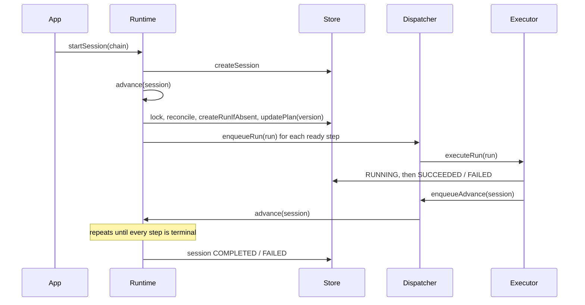

# durastep

Durable, idempotent multi-step agent pipelines on your own Postgres and Redis. A library, not a platform.

[](https://github.com/meertseker/durastep/actions/workflows/ci.yml)
[](https://www.npmjs.com/package/durastep)
[](./LICENSE)
[](./package.json)

```ts
import { createRegistry, createRuntime, defineChain, defineWorker, InlineDispatcher, MemoryStore } from "durastep";

const fetchPage = defineWorker({
  kind: "fetch-page",
  async run(ctx, input: { url: string }) {
    const res = await fetch(input.url, { signal: ctx.signal }); // aborted at the deadline
    return { text: await res.text() };
  },
});
const summarise = defineWorker({
  kind: "summarise",
  async run(ctx) {
    const page = ctx.upstream.fetch as { text: string }; // output of the "fetch" step
    return { summary: page.text.slice(0, 200) };
  },
});

const registry = createRegistry([fetchPage, summarise]);
const chain = defineChain(registry, [
  { stepId: "fetch", worker: "fetch-page" },
  { stepId: "summary", worker: "summarise", dependsOn: ["fetch"] },
]);
const runtime = createRuntime({ store: new MemoryStore(), dispatcher: new InlineDispatcher(), registry });
const session = await runtime.startSession(chain, { tenantId: "acme", inputs: { url: "https://example.com" } });
console.log(session.status); // "COMPLETED"
```

`npm run example` runs a five-step version with a fan-out, an optional step
that fails and is skipped, and a flaky step that succeeds on its second
attempt:

```
step        worker      try result     start    end  timeline
---------------------------------------------------------------------------------------------
fetch       fetch-page  1   ok           0ms   46ms  #######
enrich      enrich      1   failed      47ms   77ms         xxxxx
analyse-a   analyse     1   ok          47ms  109ms         ##########
analyse-b   analyse     1   retry       48ms  110ms         xxxxxxxxxx
analyse-b   analyse     2   ok         140ms  203ms                        ##########
summarise   summarise   1   ok         205ms  250ms                                  #######

session COMPLETED
```

## Why not Temporal / Inngest / Trigger.dev / plain BullMQ

|                                            | durastep                   | Temporal                       | Inngest / Trigger.dev           | plain BullMQ |
| ------------------------------------------ | -------------------------- | ------------------------------ | ------------------------------- | ------------ |
| What it is                                 | a library in your process  | a cluster plus SDK             | a hosted or self-hosted service | a queue      |
| Runs on                                    | your Postgres + Redis      | Temporal server + its database | their cloud, or their server    | your Redis   |
| Runtime dependencies of the core           | zero                       | SDK + server                   | SDK + service                   | ioredis      |
| Your data lives in                         | three tables you own       | Temporal's history store       | their store                     | Redis        |
| DAG of steps with fan-out / fan-in         | yes, declared              | yes, as code                   | yes, as code                    | you build it |
| Idempotent scheduling                      | yes                        | yes                            | yes                             | you build it |
| Long-lived workflows, timers, signals      | **no**                     | yes                            | yes                             | no           |
| Workflow-as-code with deterministic replay | **no**                     | yes                            | partly                          | no           |
| UI                                         | **no** (query your tables) | yes                            | yes                             | third-party  |

Pick durastep when your jobs are short multi-step pipelines (crawl, analyse,
generate) that finish in seconds to minutes, you already run Postgres and
Redis, and you want the scheduling and failure handling without adopting a
platform. Pick Temporal or Inngest when you need workflows that sleep for days,
wait for signals, or replay deterministically.

## What you get

- **Typed worker registry.** `defineWorker` infers the kind and input types; a wrong worker or input in a chain is a compile error.
- **DAG chains with validation.** Duplicate step ids, unknown workers, unknown dependencies and cycles are rejected before anything runs.
- **Race-safe scheduling.** A per-session lock, an idempotency key per (session, step) backed by a unique constraint, and an optimistic plan version; any one of them prevents double scheduling.
- **Error taxonomy.** `RetryableError`, `PermanentError(reason)` and `DeferError`, plus `classifyError` for everything else, so permanent failures stop burning retries.
- **Deadlines and a watchdog.** Every attempt races an outer deadline that aborts `ctx.signal`; dead runs are detected and failed or re-dispatched.
- **Quotas and cost ceilings.** Per-tenant monthly run caps per worker and monthly spend ceilings, from counters the executor maintains.
- **Stuck-run recovery.** `recoverStuckSessions` and `expireStuckRuns` reconcile sessions whose notifications or jobs were lost.
- **Pluggable store and dispatcher.** In-memory and inline for tests; Postgres and BullMQ for production; small interfaces for your own.
- **Telemetry hook.** `onRunFinished` fires once per attempt with duration, attempt number and cost.

## Quickstart (in-memory)

```sh
npm install durastep
```

Nothing else is needed. `MemoryStore` and `InlineDispatcher` run everything in
the current process, which is what tests and scripts want. The code at the top
of this page is a complete program.

Workers get a context:

```ts
defineWorker({
  kind: "generate-report",
  estimatedDurationMs: 20_000, // outer deadline defaults to 3x this, capped at 180 s
  deadlineMs: 120_000, // or set it explicitly
  async run(ctx, input: { topic: string }) {
    ctx.runId; // stable across attempts: use it as the idempotency key for external calls
    ctx.attempt; // 1, 2, 3...
    ctx.signal; // aborted when the deadline fires: pass it to fetch / SDK calls
    ctx.upstream; // outputs of the steps this one depends on, by stepId
    ctx.reportCost({ usdCents: 4, tokens: 2_000 });
    return { report: "..." };
  },
});
```

Throw `RetryableError` for transient failures, `PermanentError` for ones that
will never succeed, and `DeferError(ms)` when you have no capacity right now.
Anything else is classified by message and status code (timeouts, network
errors, 429 and 5xx retry; schema violations, invalid JSON, quota and 4xx do
not; unknown errors retry).

## Going durable

Postgres stores sessions, runs and counters; BullMQ carries the work. Apply the
schema once (`psql "$DATABASE_URL" -f node_modules/durastep/dist/postgres/schema.sql`
or `applySchema(pool)`), then:

```ts
import IORedis from "ioredis";
import pg from "pg";
import { createRuntime } from "durastep";
import { PostgresStore } from "durastep/postgres";
import { BullMQDispatcher, startBullMQWorker } from "durastep/bullmq";

const connection = new IORedis(process.env.REDIS_URL!, { maxRetriesPerRequest: null });
const runtime = createRuntime({
  store: new PostgresStore({ pool: new pg.Pool({ connectionString: process.env.DATABASE_URL }) }),
  dispatcher: new BullMQDispatcher({ connection }),
  registry,
});

// In your API:
await runtime.startSession(chain, { tenantId, subjectId, inputs });

// In your worker deployment (also runs recovery every 60 s):
const worker = startBullMQWorker(runtime, { connection, concurrency: 20 });
process.on("SIGTERM", () => void worker.close());
```

`pg`, `bullmq` and `ioredis` are optional peer dependencies; the core never
imports them. See [examples/postgres](./examples/postgres/README.md) and
[examples/bullmq](./examples/bullmq/README.md).

## Concepts

- **Worker**: a typed async function with a kind, timing metadata and an optional input parser.
- **Chain**: a DAG of steps; each step names a worker, its dependencies, optional static inputs, and whether it is optional.
- **Session**: one chain instance for a tenant (and optionally a subject), with the plan and per-step status.
- **Run**: one worker execution for one step, with status, attempts, output, error and cost.
- **Orchestrator** (`advance`): reconciles step status from runs, schedules ready steps, detects completion.
- **Executor** (`executeRun`): checks quota, runs the worker against its deadline, records the outcome, advances the session.
- **Store / Dispatcher**: where state lives and how work moves.



More in [docs/concepts.md](./docs/concepts.md).

## Guarantees

Short version, in production configuration (Postgres + BullMQ + recovery):

- **At most one run per (session, step)**, enforced by a unique constraint, even if the lock fails.
- **Dependencies first**: a step is scheduled only after its dependencies are SUCCEEDED (or SKIPPED, for optional ones).
- **At-least-once execution**: a scheduled run is executed at least once, and may be executed more than once (stalled workers, ignored abort signals, crashes between the worker returning and the result being written). There is **no exactly-once**: use `ctx.runId` as the idempotency key for external side effects.
- **Eventual termination**: every session reaches COMPLETED or FAILED, provided recovery runs.
- **Quotas are soft**: concurrent runs can overshoot a limit by the number of runs in flight.

[docs/guarantees.md](./docs/guarantees.md) walks through what happens when a
process dies at each point of the lifecycle.

## API reference

| export                                                                                    | from                | what it does                                                                |
| ----------------------------------------------------------------------------------------- | ------------------- | --------------------------------------------------------------------------- |
| `defineWorker(def)`                                                                       | `durastep`          | declares a worker; infers kind and input / output types                     |
| `createRegistry(workers)`                                                                 | `durastep`          | typed lookup: `get(kind)`, `has`, `kinds()`                                 |
| `defineChain(registry?, steps)`                                                           | `durastep`          | declares a chain; with a registry, type-checks and validates it             |
| `validateChain(chain, registry)`                                                          | `durastep`          | throws `ChainValidationError` on duplicates, unknown workers / deps, cycles |
| `createRuntime(options)`                                                                  | `durastep`          | binds store, dispatcher, registry, quota, telemetry, logger                 |
| `runtime.startSession(chain, { tenantId, subjectId?, inputs? })`                          |                     | creates a session and advances it                                           |
| `runtime.advance(sessionId)`                                                              |                     | one DAG walk; safe to call any time, concurrently                           |
| `runtime.executeRun(runId, { isRetry?, canDefer?, finalAttempt? })`                       |                     | executes one run (dispatchers call this)                                    |
| `runtime.recoverStuckSessions({ olderThanMs?, limit?, tenantId? })`                       |                     | re-advances sessions with nothing in flight                                 |
| `runtime.expireStuckRuns({ now?, maxPendingMs? })`                                        |                     | applies the watchdog to live runs                                           |
| `runtime.getSession(id)`, `runtime.getRuns(sessionId)`                                    |                     | reads                                                                       |
| `RetryableError`, `PermanentError`, `DeferError`                                          | `durastep`          | the error taxonomy                                                          |
| `classifyError(err, matchers?)`, `toTaxonomyError`                                        | `durastep`          | classification of anything else                                             |
| `computeIdempotencyKey(input)`                                                            | `durastep`          | the run key: sha256 of the canonicalised tuple                              |
| `deadlineFor(meta)`, `watchdogVerdict(run, meta, now)`                                    | `durastep`          | deadline and dead-run rules                                                 |
| `monthlyCount(limits)`, `costCeiling({ monthlyUsdCents })`, `allQuotas(...)`, `UNLIMITED` | `durastep`          | quota policies                                                              |
| `MemoryStore`, `InlineDispatcher`                                                         | `durastep`          | in-process store and dispatcher                                             |
| `Store`, `Dispatcher`                                                                     | `durastep`          | interfaces for your own implementations                                     |
| `PostgresStore`, `applySchema`, `SCHEMA_SQL`                                              | `durastep/postgres` | Postgres store and its DDL                                                  |
| `BullMQDispatcher`, `startBullMQWorker`, `processJob`                                     | `durastep/bullmq`   | BullMQ dispatcher and worker                                                |

Every export has JSDoc; your editor shows the details.

## Where this comes from

durastep was extracted from the AI pipeline that ran in production at Revint, a
sales-intelligence product, with about 40 worker kinds over BullMQ and Postgres.
The scheduling, idempotency and error-taxonomy code is what survived six months
of real retries, duplicate webhooks and stuck runs. The provider clients, the
vector memory and the product's plan tiers were deliberately left out. What
changed in the extraction, and why, is in [docs/design.md](./docs/design.md).

## Roadmap

Next up: cancelling sessions, completing externally-waiting runs from a
webhook, per-worker concurrency limits in the dispatchers, and an OpenTelemetry
adapter for the telemetry hook. See [ROADMAP.md](./ROADMAP.md).

## Contributing

Issues and pull requests are welcome. `npm test` needs nothing installed;
the Postgres and BullMQ suites run when `DATABASE_URL` / `REDIS_URL` are set.
See [CONTRIBUTING.md](./CONTRIBUTING.md).

## License

[MIT](./LICENSE) © 2026 Mert Seker
