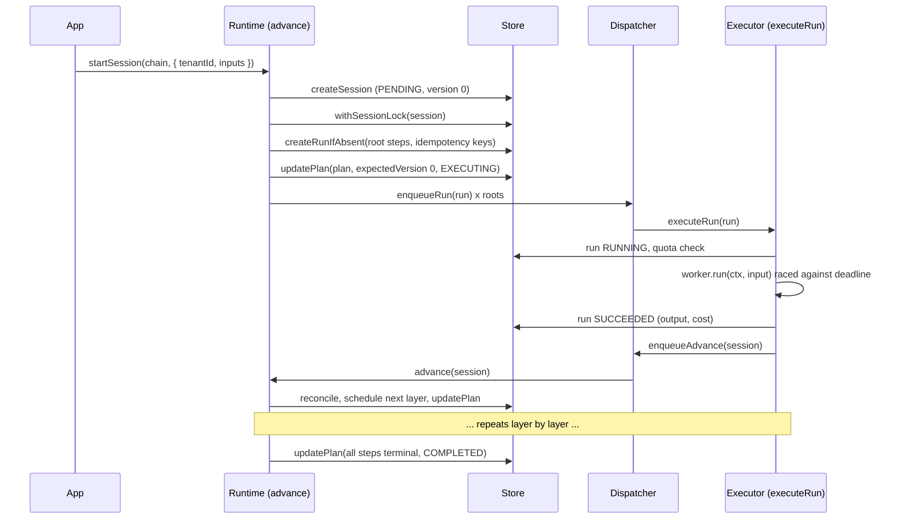

# Concepts

durastep has seven moving parts. Two of them (store and dispatcher) are
interfaces you can swap; the rest is the core.

## Worker

A unit of work: an async function with a stable `kind`.

```ts
const analyse = defineWorker({
  kind: "analyse",
  estimatedDurationMs: 10_000,
  parseInput: (raw) => schema.parse(raw), // optional; a throw is PermanentError("input")
  async run(ctx, input: { lens: "tone" | "facts" }) {
    return { score: 0.8 };
  },
});
```

`run` receives a `WorkerContext`:

| field                                          | meaning                                                                                         |
| ---------------------------------------------- | ----------------------------------------------------------------------------------------------- |
| `runId`                                        | stable across attempts; use it as the idempotency key for external calls                        |
| `sessionId`, `stepId`, `tenantId`, `subjectId` | where the run belongs                                                                           |
| `attempt`                                      | 1-based; deferrals do not count                                                                 |
| `signal`                                       | aborted when the outer deadline fires                                                           |
| `canDefer`, `deferCount`                       | whether `DeferError` is honoured, and how often this run was deferred                           |
| `queuedAt`                                     | when the run row was created                                                                    |
| `upstream`                                     | outputs of the steps this step depends on, by step id (`undefined` for a skipped optional step) |
| `logger`                                       | the runtime's logger                                                                            |
| `reportCost({ usdCents, tokens })`             | spend for this attempt; recorded on success, read by `costCeiling`                              |

The input a worker receives is the session's `inputs` merged under the step's
static `inputs`.

## Registry

`createRegistry([a, b, c])` is an immutable, typed map from kind to worker.
Duplicate kinds throw. The registry is what chain validation checks worker
names against, and what the executor looks workers up in.

## Chain

A DAG of steps:

```ts
const chain = defineChain(registry, [
  { stepId: "fetch", worker: "fetch-page" },
  { stepId: "tone", worker: "analyse", dependsOn: ["fetch"], inputs: { lens: "tone" } },
  { stepId: "facts", worker: "analyse", dependsOn: ["fetch"], inputs: { lens: "facts" } },
  { stepId: "extra", worker: "enrich", dependsOn: ["fetch"], optional: true },
  { stepId: "report", worker: "summarise", dependsOn: ["tone", "facts", "extra"] },
]);
```

- Steps with no `dependsOn` are roots and start in parallel. So do all steps
  whose dependencies finish at the same time (`tone`, `facts`, `extra` above).
- `optional: true` means a failure ends the step SKIPPED and the chain
  continues; dependants see `undefined` in `ctx.upstream`.
- A failure of a non-optional step fails the session. Steps that have not
  started are marked SKIPPED; steps already running finish first.
- `validateChain` rejects empty chains, duplicate step ids, unknown workers,
  unknown dependencies and cycles. `defineChain(registry, steps)` and
  `startSession` both validate.

With a registry, `worker` must be a registered kind and `inputs` must be a
partial of that worker's input type, checked at compile time.

## Session

One chain instance: `{ id, tenantId, subjectId, status, inputs, plan, version }`.
The `plan` is the chain plus per-step `status` and `runId`; `version` is the
optimistic-concurrency token bumped on every plan write.

Session status: `PENDING` (created) -> `EXECUTING` -> `COMPLETED` or `FAILED`.
(`CANCELLED` is in the type for stores that set it; v0.1 has no cancel API.)

Step status: `PENDING` -> `RUNNING` -> `SUCCEEDED`, `FAILED` or `SKIPPED`.

## Run

One worker execution for one step: status, inputs, output, error,
`attempt`, `deferCount`, timestamps and cost. Its `idempotencyKey` is
`sha256(tenantId, worker, subjectId, inputs, sessionId, stepId)` with keys
sorted recursively, and the store keeps `(tenantId, idempotencyKey)` unique.

Run status: `PENDING` -> `RUNNING` -> `SUCCEEDED` or `FAILED`. A retryable
failure is written as `FAILED` with an error starting `retryable: `; the
orchestrator treats that as still in flight until the retry lands.

## Orchestrator: `advance(sessionId)`

1. Take the session lock (non-blocking; if held, return `locked`).
2. Reload the session; reconcile each step's status from its run's status.
3. If a non-optional step failed, schedule nothing more.
4. For every PENDING step whose dependencies are SUCCEEDED or SKIPPED: derive
   the idempotency key, `createRunIfAbsent`, mark the step RUNNING.
5. Persist the plan with `updatePlan(id, plan, expectedVersion, status)`. On a
   version conflict, dispatch nothing and return `conflict`.
6. Mark the session COMPLETED or FAILED when every step is terminal.
7. Release the lock, then `dispatcher.enqueueRun` each new run.

`advance` is idempotent: calling it again with nothing changed does nothing.

## Executor: `executeRun(runId)`

1. Load the run; only PENDING / RUNNING (or FAILED on a retry) proceed. Mark
   it RUNNING and count the attempt.
2. Check the quota policy; a denial is `PermanentError("quota")`.
3. Run the worker against its outer deadline (`deadlineMs`, else
   3 x `estimatedDurationMs` capped at 180 s). The deadline aborts
   `ctx.signal` and fails the attempt with a `RetryableError`.
4. Record the outcome:
   - success: SUCCEEDED + output + cost, then (best-effort) usage counters,
     telemetry and `enqueueAdvance`;
   - `DeferError` with `canDefer`: back to PENDING, `deferCount + 1`;
   - retryable: FAILED with the retry marker, rethrow for the dispatcher;
   - permanent (or retryable on the final attempt): FAILED, telemetry,
     `enqueueAdvance`.

## Store and dispatcher

```ts
interface Store {
  createSession;
  getSession;
  updatePlan;
  withSessionLock;
  createRunIfAbsent;
  getRun;
  updateRun;
  listRuns;
  listSessions;
  incrementCounter;
  getCounter;
}
interface Dispatcher {
  enqueueRun(runId): Promise<void>;
  enqueueAdvance(sessionId): Promise<void>;
  bind?(handlers): void; // receives executeRun / advance from createRuntime
}
```

|            | development        | production                                                                                     |
| ---------- | ------------------ | ---------------------------------------------------------------------------------------------- |
| store      | `MemoryStore`      | `PostgresStore` (`durastep/postgres`)                                                          |
| dispatcher | `InlineDispatcher` | `PostgresDispatcher` + `startPostgresWorker` (`durastep/postgres`), no Redis                   |
|            |                    | or `BullMQDispatcher` + `startBullMQWorker` (`durastep/bullmq`), if you already run Redis      |

## Recovery

- `recoverStuckSessions({ olderThanMs })`: re-advances PENDING / EXECUTING
  sessions with no referenced run in flight whose plan has not been written
  for `olderThanMs`. Covers lost advance notifications.
- `expireStuckRuns()`: applies `watchdogVerdict` to PENDING, RUNNING and
  retry-pending runs. Dead runs that started are failed (their sessions
  advanced); dead runs that never started are re-dispatched.

Both are idempotent and safe to run on a timer in every process.

## End to end


